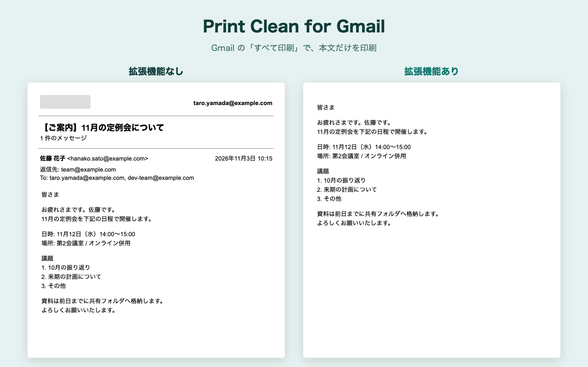

# Print Clean for Gmail

Gmail の「すべて印刷」画面で、アカウント欄・件名・送信元・日時・宛先を隠し、本文だけを印刷できるようにする Chrome 拡張機能（Manifest V3）です。

A Chrome extension that hides the account bar, subject, sender, date and recipients in Gmail's print view, so only the message body is printed.

対応言語 / Languages: 日本語・English（Chrome の表示言語に合わせて自動で切り替え。その他の言語では英語 / follows Chrome's UI language, English otherwise）



## 安全性 / Security

メールには読まれたくない情報が多いため、この拡張機能は「何もしない」ことを優先して作っています。コードは短いので、直接確認できます。

| 項目 | 内容 |
|---|---|
| 権限 | `storage` のみ（表示設定の保存用）。`host_permissions` なし。ただしコンテンツスクリプトの対象が `mail.google.com` のため、インストール時に Chrome は「mail.google.com のデータの読み取りと変更」の警告を表示します |
| 動作するページ | `https://mail.google.com/mail/*` のうち、URL に `view=pt` を含む印刷画面だけ（[`manifest.json`](extension/manifest.json)） |
| 通信 | なし。`fetch` / `XMLHttpRequest` などの通信処理はありません |
| メールの読み取り | なし。[`content.js`](extension/content.js) は `<html>` にクラスを付け外しし、準備完了を示す `data-gpc-ready` 属性を 1 つ付けるだけで、非表示は [`content.css`](extension/content.css) が行います |
| MAIN world スクリプト | [`print-gate.js`](extension/print-gate.js) は印刷画面の `window.print` を包み、設定の読み込み前に呼ばれた `window.print()` すべて（自動で開く印刷ダイアログを含む）を、表示設定の反映まで最大 1.5 秒待たせるだけです。`<html>` の `data-gpc-ready` 属性を 1 つ確認するだけで、ページのデータは読まず、送りません |
| 保存するデータ | 5 項目それぞれの表示オン・オフだけ（`chrome.storage.sync`） |

- Permissions: `storage` only. No `host_permissions`. Because the content script targets `mail.google.com`, Chrome shows a "read and change your data on mail.google.com" warning at install time.
- Runs only on Gmail's print view (`view=pt`). No network requests. Does not read message content.
- `print-gate.js` (MAIN world) only wraps `window.print` so printing waits up to 1.5 s until your display settings are applied.

プライバシーポリシー / Privacy policy: https://ext.ykich.work/print-clean-for-gmail/privacy/

## 使い方 / Usage

1. Gmail でメールを開き、プリンターのアイコン（すべて印刷）を押します。
2. 印刷プレビューには本文だけが表示されます。
3. 拡張機能のアイコンを押すと、印刷に表示する項目を選べます（既定はすべて非表示）。

## ソースからインストール / Install from source

1. このリポジトリを clone します。
2. Chrome で `chrome://extensions` を開き、デベロッパーモードをオンにします。
3. 「パッケージ化されていない拡張機能を読み込む」で `extension/` フォルダを選びます。

## 開発 / Development

```bash
npm test          # node:test でテスト（Node.js 24 以上）
npm run package   # dist/print-clean-for-gmail-<version>.zip を作成（コミット済みのファイルだけを含む）
```

| パス | 内容 |
|---|---|
| `extension/` | 拡張機能の本体（ストアに提出する ZIP の中身）と `test/` |
| `store/` | ストアの入力ガイド（[`store/README.md`](store/README.md)）、詳細説明、プライバシー欄の文面、プライバシーポリシーの原稿 |
| `site/` | https://ext.ykich.work に公開する静的ページ |
| `tools/dump-skeleton.js` | Gmail の印刷画面の DOM 構造だけを取り出すスクリプト（文字は伏せ字にする） |
| `docs/SPEC.md` | 設計メモ |

## 既知の制限 / Known limitations

- Gmail の印刷画面の構造が変わると、項目が隠れなくなる場合があります。
- 動作確認は、1 通だけのスレッドと、複数のメッセージを含むスレッドで行っています。印刷を待たせる処理（`print-gate.js`）も、実際の Gmail で確認済みです。

## 免責 / Disclaimer

Google の公式製品ではなく、Google LLC とは提携・承認の関係にありません。Gmail は Google LLC の商標です。

Not affiliated with or endorsed by Google LLC. Gmail is a trademark of Google LLC.

## License

[MIT](LICENSE)
